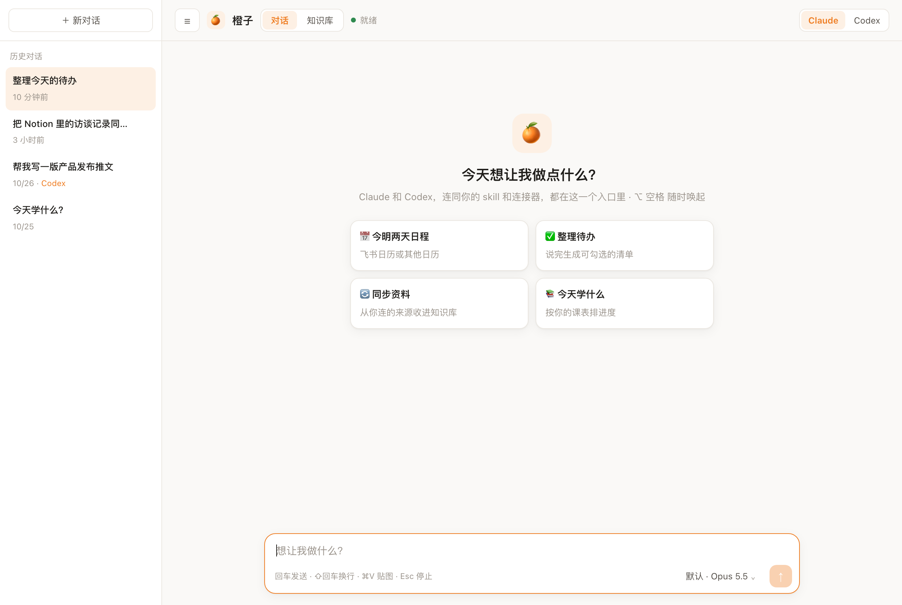
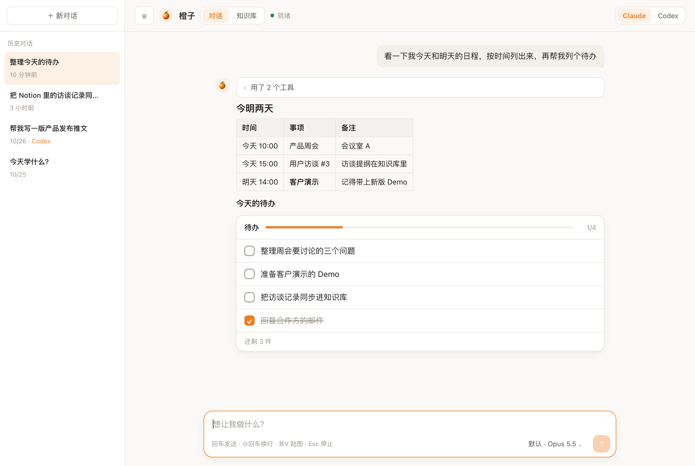
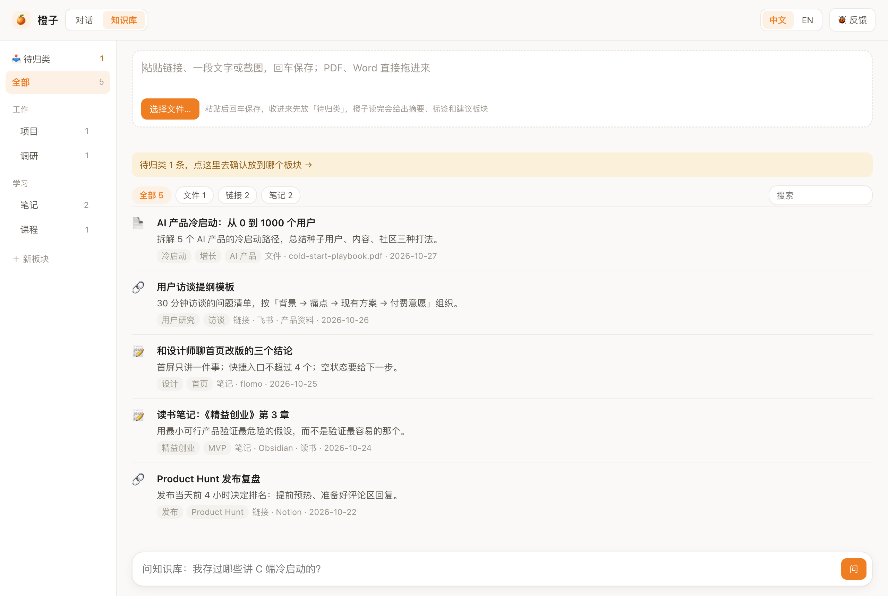
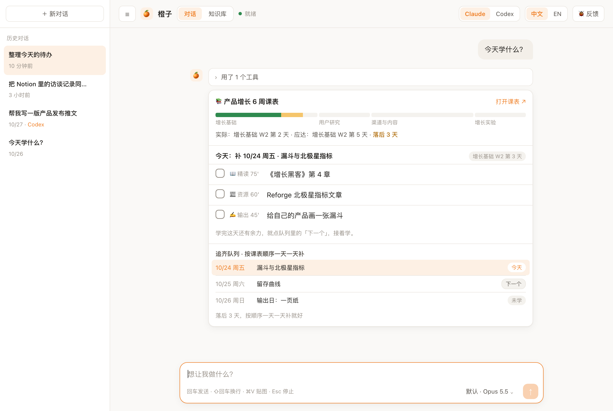

# 橙子 🍊

**按 ⌥ 空格就能唤起的 AI 桌面助手：Claude 和 Codex 随手切换，记忆不丢，飞书和 flomo 直接打通。**

[English](README.en.md) · 中文



橙子是一个 macOS 桌面窗口，后台接的是 Claude Code（`claude`）或 Codex（`codex`）命令行。你说一句话，它调用对应的工具把事办完。

## 为什么用橙子

- **两家后端，一份记忆**：右上角一键切换 Claude / Codex。两家读同一个 `AGENTS.md` 和同一个记忆目录，换后端不用重新交代。
- **随叫随到**：⌥ 空格在任何地方唤起；待办会渲染成可勾选的卡片。
- **自带知识库，数据源跟着你的 Claude 走**：你在 Claude 或 Codex 里连了 flomo、Notion 等，对话里说一句「同步进知识库」就行；Obsidian 填个路径就行。网页、PDF、截图也能直接收。回答问题时先查你自己的资料，并附上原文链接。
- **中文办公生态**：飞书（通过 lark-cli）、flomo、Notion 开箱即用。
- **可以 DIY**：改 JSON 就能换配置；加一个 md 文件就多一种模式；界面就是一个 HTML 文件，改完重开就生效。

## 看看长什么样

| 对话：日程和可勾选的待办 | 知识库：资料自动摘要、打标签、分板块 |
|---|---|
|  |  |

| 自定义模式示例：按课表排学习进度 |
|---|
|  |

> 截图里是演示数据。界面支持中文 / English 一键切换（右上角「中文 | EN」），默认跟随系统语言。

## 安装

### 方式一：让 AI 帮你装（推荐）

把下面这句话发给你的 Claude Code 或 Codex：

> 请阅读 https://github.com/lxu0101/orange-desk/blob/main/INSTALL.md ，按步骤帮我安装橙子。

它会一步步检查和执行，过程中每一步都会请你确认。

### 方式二：自己装

需要 macOS 13+，并已安装 Xcode 命令行工具（`xcode-select --install`）。

```bash
git clone https://github.com/lxu0101/orange-desk.git ~/orange-desk
cd ~/orange-desk && make
```

然后双击 `橙子.app`。

> 橙子.app 要留在这个文件夹里（它从旁边读 `ui.html` 和 `config.json`）。想放进 Dock，直接把它拖到 Dock 上就行，不要移动它。

### 第一次用：登录后端

至少登录其中一个：
- **Claude**：安装 [Claude 桌面版](https://claude.ai/download) 或 Claude Code，在终端运行 `claude`，然后输入 `/login`
- **Codex**：安装 ChatGPT 桌面版或 Codex CLI，运行 `codex login`

## 使用

| 操作 | 作用 |
|---|---|
| ⌥ 空格 | 唤起 / 收起 |
| 回车 / ⇧回车 | 发送 / 换行 |
| Esc | 停止当前任务 |
| ⌘V | 粘贴截图 |
| 右上角 Claude \| Codex | 切换后端（会新开一个对话） |
| 输入框右下角 | 切换模型 |

## 自己改（DIY）

| 想改什么 | 改哪里 | 要重新编译吗 |
|---|---|---|
| 后端、模型、权限、工作目录 | `config.json` | 不用，重开橙子即可 |
| 你的偏好、规则、记忆 | `~/Orange/AGENTS.md`、`~/Orange/shared/memory/` | 不用 |
| 首页快捷按钮（图标、标题、点击后发给 AI 的 prompt） | 复制 `chips.example.json` 为 `chips.json` 再改，不用动代码 | 不用 |
| 名字、图标、主色（不想要橙子，换成 🍋🍑🍇 也行） | `config.json` 里的 `theme`，比如 `{"name": "柠檬", "icon": "🍋", "accent": "#e0b400"}` | 不用 |
| 界面样式 | `ui.html` | 不用 |
| 加一种「模式」 | 在 `prompts/` 里写一个 md，在 `ui.html` 里加一个按钮指向它（参考 `prompts/study.md`） | 不用 |
| 知识库接入 flomo、Notion、Obsidian、飞书等 | 在 Claude / Codex 里连好，对话里说「同步进知识库」，见下文 | 不用 |
| 同步时保留哪些主题 | `config.json` 的 `kbTopics` | 不用 |
| 窗口、快捷键等核心逻辑 | `Orange.swift` | 要，运行 `make build` |

### 知识库的数据源：在对话里说就行

橙子不自己对接任何数据源。你在 Claude 或 Codex 里连了什么连接器（flomo、Notion、Google Drive……），就在对话里告诉它，比如「把我 flomo 里最近的笔记同步进知识库」，或者点首页的「🔄 同步资料」。它会按 `AGENTS.md` 里的规则（橙子第一次打开知识库时写进去）取新增内容，存成统一格式，带原文链接，已处理过的不会重复导入。

- 对话页右上角选哪个后端，就用哪家连接器。两边连的东西不一样：比如 flomo 在 Claude 里，Codex 里可能没有。
- Obsidian：`config.json` 里填 `obsidianVault`，再对它说「同步 Obsidian」，它会运行 `obsidian_sync.py`，直接读本地文件，不用逐条让 AI 处理。
- 飞书文件夹：复制 `feishu_folders.example.json` 为 `feishu_folders.json` 填上 token，再对它说「同步飞书」。
- 同步是一次 AI 任务，会消耗额度。提示里要求它只用读取类工具，但这是提示词层面的约束，不是技术隔离；不放心的话，别把写入类工具放进 `allowedTools`。
- 知识库页的「选择文件…」会弹出系统文件对话框，也可以直接把 PDF、Word、截图拖进来，或粘贴链接和文字后回车保存。

### 权限说明

为了不在窗口里弹确认，橙子只允许使用 `config.json` 里 `allowedTools` 列出的工具。某个工具被拦下时，对话里会提示它的名字，加进列表后重开橙子即可。Codex 一侧靠沙箱限制，默认只能写工作目录。

## 常见问题

- **登录时报 403 / 连不上**：如果你在用代理，在 `config.json` 的 `proxy` 里填代理地址（比如 `http://127.0.0.1:7890`）。橙子默认会读系统代理。
- **找不到 claude / codex 程序**：在 `config.json` 里填 `claudePath` / `codexPath`。

## 遇到 Bug / 联系作者

- 点橙子右上角的 **🐞 反馈**，会自动打开一封写好模板的邮件
- 或直接发邮件到 **lxu0101@gmail.com**，最好附上截图（截图前看一下有没有私人资料）
- 会用 GitHub 的话，也可以提 [Issue](https://github.com/lxu0101/orange-desk/issues)

## 参与贡献

欢迎提 Issue 和 PR（怎么改见 [CONTRIBUTING.md](CONTRIBUTING.md)），特别欢迎：新的模式（`prompts/`）、新的知识库数据源（Notion、Obsidian……）、界面主题。

如果橙子对你有用，欢迎点个 ⭐ Star，这对我们帮助很大。

## License

MIT
